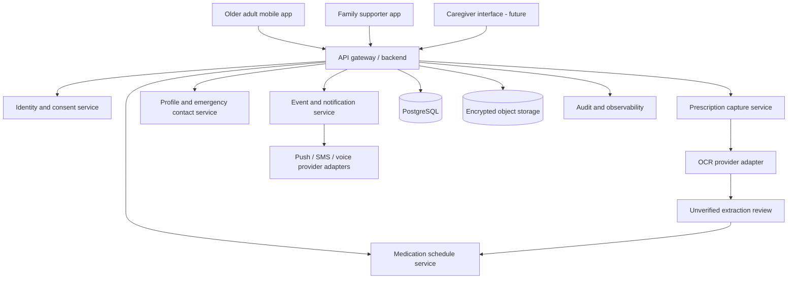

# Conceptual System Architecture

This is a proposed architecture, not an implemented or tested design.

## High-level components

## Key flows

### Medication reminder
1. User creates and confirms a schedule.
2. Backend stores the schedule and next reminder.
3. Notification worker attempts delivery.
4. Delivery result is recorded separately from medication status.
5. User reports taken or skipped; otherwise the event remains unconfirmed.
6. Authorised family dashboard reads the shared event.

### Prescription capture
1. User uploads an image with permission.
2. Image is stored securely for the minimum required period.
3. OCR adapter returns candidate text and confidence metadata.
4. User reviews the extracted fields.
5. Only user-confirmed fields can be used to draft a medication schedule.
6. Ambiguous values require external clarification; the system must not infer a dose.

### SOS
1. User initiates SOS and reviews the sharing action.
2. Backend attempts to notify configured contacts.
3. Delivery and acknowledgement are tracked as separate states.
4. Location is included only when permission and device capability allow it.
5. The interface presents failure and fallback states explicitly.

## Suggested technology options
- Client: Flutter or React Native.
- API: FastAPI or Node.js.
- Database: PostgreSQL.
- OCR: provider adapter around a selected OCR service.
- Voice: speech-to-text and text-to-speech adapters; evaluate Indian-language support.
- Infrastructure: a cloud region and hosting model selected after privacy, security, and cost review.

These are candidate technologies from the original proposal, not confirmed implementation decisions.

## Architecture decisions still required
- Authentication model and account recovery.
- Consent and delegated access model.
- Data retention and deletion policies.
- Notification queue, retries, and idempotency.
- Offline behaviour and conflict resolution.
- Encryption key management and audit retention.
- Applicable privacy, health-data, and emergency-service requirements.
